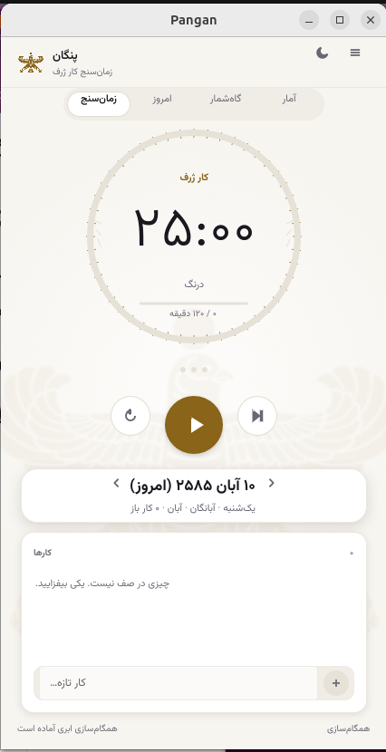
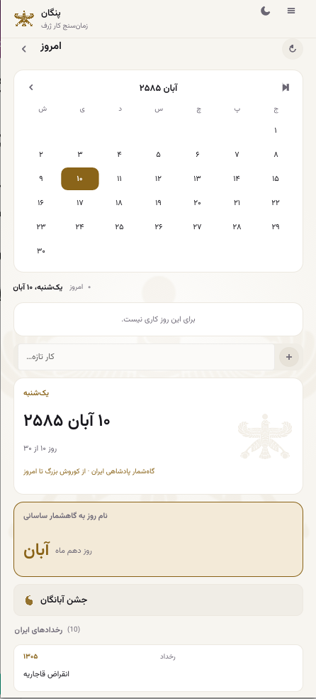
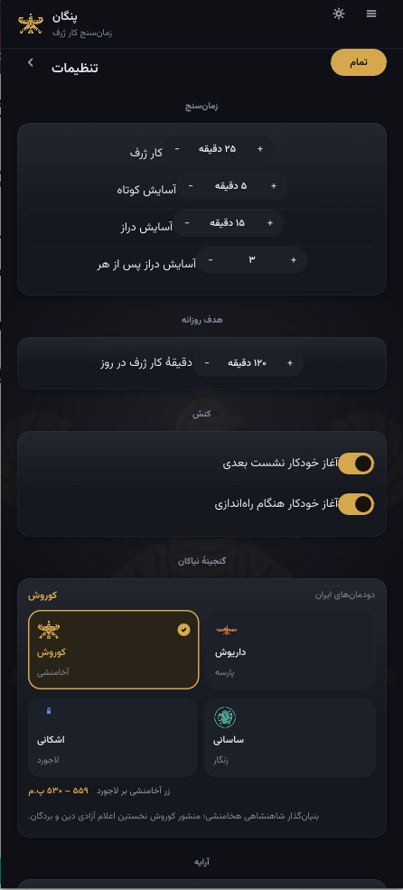
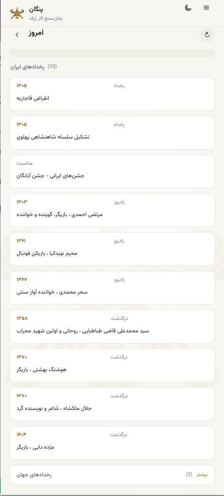
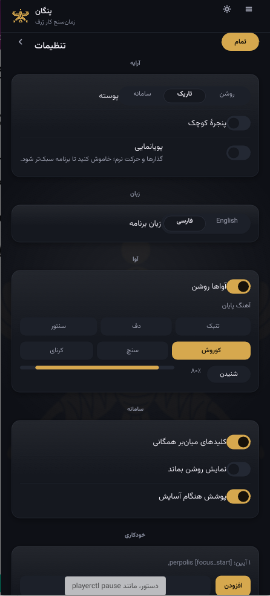
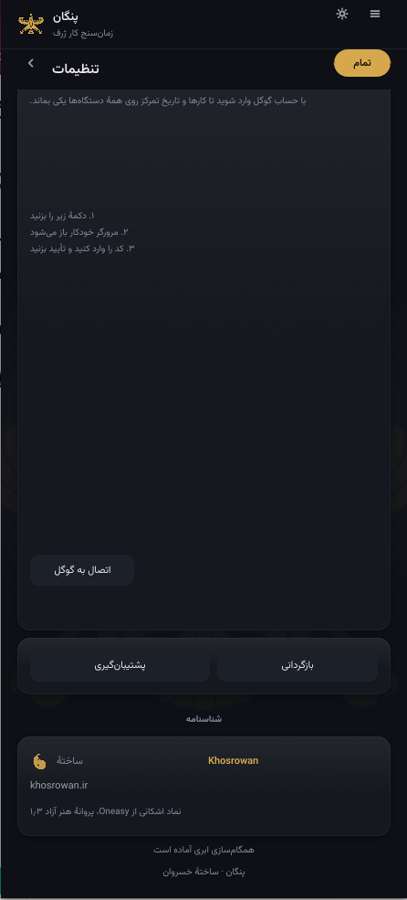

<div align="center">

# Pangan · پنگان

### Focus deeply. Plan meaningfully. Make time count.

**A free, open-source Pomodoro timer and productivity app, inspired by Iranian timekeeping.**  
Built with **Rust** and **Slint**, with a Persian calendar, task planning, and a focus journal.

<p>
  <a href="https://github.com/DariushKhosrowan/pangan/releases/latest"></a>
  <a href="https://github.com/DariushKhosrowan/pangan/actions"></a>
  <a href="LICENSE"></a>
</p>

**[Download Pangan](https://github.com/DariushKhosrowan/pangan/releases/latest)** · **[Explore features](https://dariushkhosrowan.github.io/pangan/features.html)** · **[Themes](https://dariushkhosrowan.github.io/pangan/themes.html)** · **[Calendar](https://dariushkhosrowan.github.io/pangan/calendar.html)** · **[Build from source](#build-from-source)** · **[Contribute](#contributing)**

<sub>Desktop: Linux · Windows · macOS | Mobile: Android APKs + iOS simulator build</sub>

<sub>🏠 [Project website](https://dariushkhosrowan.github.io/pangan/) · ⭐ [Star on GitHub](https://github.com/DariushKhosrowan/pangan)</sub>

</div>

---

## Meet Pangan

*Pangan* (پنگان) is named after a traditional Persian water clock. Its purpose is simple: turn time into focused work—without losing sight of your intentions or the rhythm of your day.

Pangan brings together a customizable **Pomodoro timer**, **daily tasks**, three calendar reckonings (**Jalali, Gregorian, and Hijri**), historical Iranian day names and events, **focus statistics**, and an optional **Google Drive sync**. It is built as a native Rust application rather than a browser tab.

### Highlights

- **Three calendars** — switch between the Persian Jalali calendar, the Gregorian calendar, and the Hijri (Islamic) calendar. Tasks and journal stay anchored to the same real days no matter which reckoning you view.
- **Eight themes** — four Iranian heritage eras (Cyrus, Darius, Parthian, Sasanid) plus Rose, Teal, Violet, and Olive, each in dark and light.
- **Native & fast** — a single Rust binary that starts instantly and respects your resources.
- **Private by default** — runs offline, data stored locally, optional Google Drive sync.

## A look inside

<div align="center">
<table>
  <tr>
    <td align="center" width="33%"><a href="docs/screenshots/01-focus-timer.png"></a></td>
    <td align="center" width="33%"><a href="docs/screenshots/02-persian-calendar.png"></a></td>
    <td align="center" width="33%"><a href="docs/screenshots/03-historical-themes.png"></a></td>
  </tr>
  <tr>
    <td align="center"><sub><b>Focus timer</b><br />A calmer way to work</sub></td>
    <td align="center"><sub><b>Persian calendar</b><br />Time in cultural context</sub></td>
    <td align="center"><sub><b>Historical themes</b><br />A distinctive visual identity</sub></td>
  </tr>
</table>
</div>

<details>
<summary><b>View more screenshots</b> — events, personalization, and cloud sync</summary>
<br />
<div align="center">
<table>
  <tr>
    <td align="center"><a href="docs/screenshots/04-iranian-events.png"></a></td>
    <td align="center"><a href="docs/screenshots/05-appearance-and-audio.png"></a></td>
    <td align="center"><a href="docs/screenshots/06-cloud-sync.png"></a></td>
  </tr>
  <tr>
    <td align="center"><sub>Iranian events</sub></td>
    <td align="center"><sub>Personalization</sub></td>
    <td align="center"><sub>Cloud sync</sub></td>
  </tr>
</table>
</div>
</details>

---

## What you can do

### Focus without distractions

Set work, short-break, and long-break durations that fit your routine. Follow the circular progress timer, use quick session controls, and let the app handle the transition between sessions. A compact window mode is available when you want Pangan to take up less space.

### Plan the day, not just the next 25 minutes

Use tasks and a **daily rota** to connect focus sessions to specific work. Record your intentions before starting, then review what you actually completed.

### Explore three calendars

Navigate the **Persian Jalali calendar**, the **Gregorian calendar**, or the **Hijri (Islamic) calendar** — with Iranian historical events and traditional **Sasanian day names**. Pangan also brings Iranian historical motifs into its appearance themes, including **Cyrus, Darius, Parthian, and Sasanian** heritage styles plus **Rose, Teal, Violet, and Olive** modern palettes.

### Understand your progress

See time spent focusing, completed sessions, and productivity trends. Pangan's journal features make it possible to reflect on the *outcome* of your work—not only the minutes counted.

### Make it yours

Choose light or dark appearance, Persian or English language, focus-session behavior, and Iranian-inspired procedural sounds. Desktop integrations include optional global hotkeys and automation commands.

### Keep your data under your control

Pangan stores productivity data locally and supports optional synchronization through your own Google Drive account, alongside backup and restore controls. Google Drive authorization may require configuration depending on the build.

### Stay current, automatically

The desktop build checks GitHub Releases on launch (once, in the background) and,
when a newer version exists, downloads, verifies, and applies it itself — no
manual upgrade step. A few notes:

- The check is quiet and non-blocking; the app opens instantly and checks behind
  the scenes.
- Downloads are verified against the release's SHA-256 sidecar before being
  swapped in, and the swap is atomic (the running app is never half-updated).
- Enabled by default; turn it off by setting `auto_update = false` in
  `~/.config/pangan/config.toml`.
- Installs made via the one-command installer update the native binary in place.
  AppImage-launcher installs report that a manual refresh is the right move
  (`auto_update` is ignored for those).
- It is a **desktop** feature — the Android/iOS builds do not self-update.

---

## Download

Find the latest available desktop and mobile packages and checksums on the **[Releases page](https://github.com/DariushKhosrowan/pangan/releases/latest)**.

| Platform | Easiest option | What you get |
| --- | --- | --- |
| Linux | **AppImage** `Pangan-<version>-x86_64.AppImage` | A single self-contained executable. Just download, `chmod +x`, run. No install required. |
| Linux | Plain binary `pangan-linux-x86_64` | Requires the system libraries listed below. |
| Windows | **Portable ZIP** `Pangan-<version>-windows-x86_64-portable.zip` | Unzip anywhere; double-click `Pangan.exe`. No installer, no admin rights. |
| Windows | Plain binary `pangan-windows-x86_64.exe` | Standalone executable (Qt-free, statically linked). |
| Android | `pangan-android-universal.apk` | One file for all 64-bit ABIs. |
| iOS | `pangan-ios-simulator.app.zip` | Simulator build. |

### Linux

**One command (recommended)** — auto-detects your distro + CPU, downloads the
latest release, installs any missing runtime libraries, and registers the app:

```bash
curl -fsSL https://raw.githubusercontent.com/DariushKhosrowan/pangan/main/packaging/install.sh | bash
```

That's it. You'll find Pangan in your app menu (or run `pangan`). Per-user
install with no root: add `--user`. Handy options: `--user` (no root),
`--appimage <path>` (use a downloaded AppImage), `--skip-deps` (never touch the
package manager), `--autostart` (launch at login), `--dry-run` (preview).

**AppImage (alternative)** — no installation and no dependencies:

```bash
# Download the matching Pangan-<version>-x86_64.AppImage from the latest release
# (https://github.com/DariushKhosrowan/pangan/releases/latest), then:
chmod +x Pangan-<version>-x86_64.AppImage
./Pangan-<version>-x86_64.AppImage
```

The AppImage runs as-is — no install needed. To add it to your application
menu, either:
- install [AppImageLauncher](https://github.com/TheAssassin/AppImageLauncher)
  (once) and double-click the AppImage, or
- use your desktop's built-in AppImage integration (e.g. GNOME's
  `appimaged`), which registers it automatically.

On the rare systems with neither, you can register it manually with the
bundled installer script:

```bash
sudo ./packaging/install.sh --appimage ./Pangan-<version>-x86_64.AppImage
```

**Plain binary** — download `pangan-linux-x86_64` (and the `install.sh`
helper from the same release), put them in the same folder, then:

```bash
chmod +x pangan-linux-x86_64
sudo ./install.sh    # installs to /usr/local/bin and registers the app menu entry
```

For a per-user install (no root), use `./install.sh --user` instead.

The plain Linux binary is dynamically linked and needs a few system libraries
(glibc ≥ 2.35 plus the X11/Wayland/xkbcommon graphics stack used by the UI).
Install them with the command for your distribution:

Ubuntu / Debian:

```bash
sudo apt install libxkbcommon0 libx11-6 libwayland-client0 libxcb1 libfontconfig1 libgl1
```

Fedora:

```bash
sudo dnf install libxkbcommon libX11 libwayland-client libxcb fontconfig mesa-libGL
```

Arch Linux:

```bash
sudo pacman -S --needed libxkbcommon libx11 wayland libxcb fontconfig mesa
```

openSUSE:

```bash
sudo zypper install libxkbcommon0 libX11-6 libwayland-client libxcb1 fontconfig
```

> Tip: if any of these are missing, Pangan will fail to open a window on
> first launch. The AppImage bundles its own graphics stack, so it avoids
> this entirely.

### Windows

**Portable ZIP (recommended)** — download `Pangan-<version>-windows-x86_64-portable.zip`, extract, and double-click `Pangan.exe`. No installation and no admin rights are needed. To uninstall, just delete the folder.

**Plain binary** — download `pangan-windows-x86_64.exe` and double-click it. It is a standalone executable; no separate runtime is required (Windows 10 1809+ / Windows 11).

### Android

Install the single `pangan-android-universal.apk` (contains arm64 and x86_64 binaries). It installs on 64-bit arm64 or x86_64 devices running Android 7.0+ (API 24). Note: 32-bit ARM (armeabi-v7a) is not supported — the Skia renderer used by the UI does not build for it at API 24. If you previously installed an older Pangan APK signed with a different key, uninstall it first or the new signature will be rejected.

## Build from source

Install a compatible [Rust toolchain](https://rustup.rs/) and the system libraries needed by Slint on your platform.

```bash
git clone https://github.com/DariushKhosrowan/pangan.git
cd pangan
cargo build --release
```

On Linux or macOS, run:

```bash
./target/release/pangan
```

On Windows, run `target\release\pangan.exe` (or launch the built executable from File Explorer).

To run the available Rust tests:

```bash
cargo test
```

To build the portable/self-contained packages locally after a release build:

```bash
cargo build --release
./packaging/build-appimage.sh                  # Linux → dist/Pangan-<version>-<arch>.AppImage
./packaging/build-windows-portable.sh          # Windows → dist/Pangan-<version>-windows-<arch>-portable.zip
```

The repository's build configuration and test scripts are the authoritative references if these commands change as mobile support is developed.

## Under the hood

| Area | Implementation |
| --- | --- |
| Core application | Rust |
| Interface | Slint |
| Calendar | Persian/Jalali and Iranian historical calendar features |
| Focus data | Locally persisted session records, tasks, and journal entries |
| Sound | Procedural Iranian-inspired audio synthesis |
| Synchronization | Optional Google Drive integration |
| Builds | GitHub Actions for supported desktop targets |

Pangan aims to remain a lightweight native tool with an identifiable Iranian character and straightforward source code.

## Contributing

Contributions are welcome, including bug reports, documentation, translations, accessibility improvements, platform fixes, and test coverage.

1. Check [existing issues](https://github.com/DariushKhosrowan/pangan/issues) before reporting a problem.
2. Keep pull requests focused and describe how you tested your changes.
3. Avoid unrelated interface changes in backend or platform-specific contributions.

[Open an issue](https://github.com/DariushKhosrowan/pangan/issues/new) · [Browse the source](https://github.com/DariushKhosrowan/pangan)

## Why the name Pangan?

**پنگان** refers to a traditional Persian water clock once used to divide and measure time. The name connects a historical approach to timekeeping with a modern tool for attention, planning, and reflection.

---

<div align="center">

**Make time for what matters.**

[Releases](https://github.com/DariushKhosrowan/pangan/releases) · [Issues](https://github.com/DariushKhosrowan/pangan/issues) · [Source](https://github.com/DariushKhosrowan/pangan)

<sub>Created by <a href="https://github.com/DariushKhosrowan">Dariush Khosrowan</a> · <a href="LICENSE">MIT License</a></sub>

</div>
